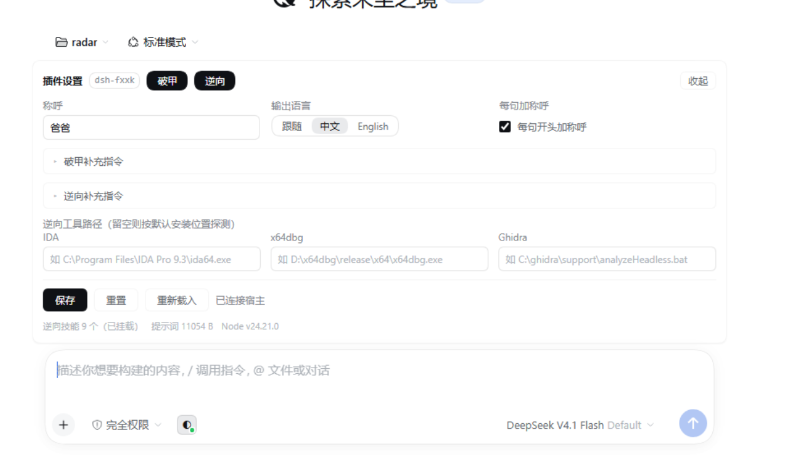
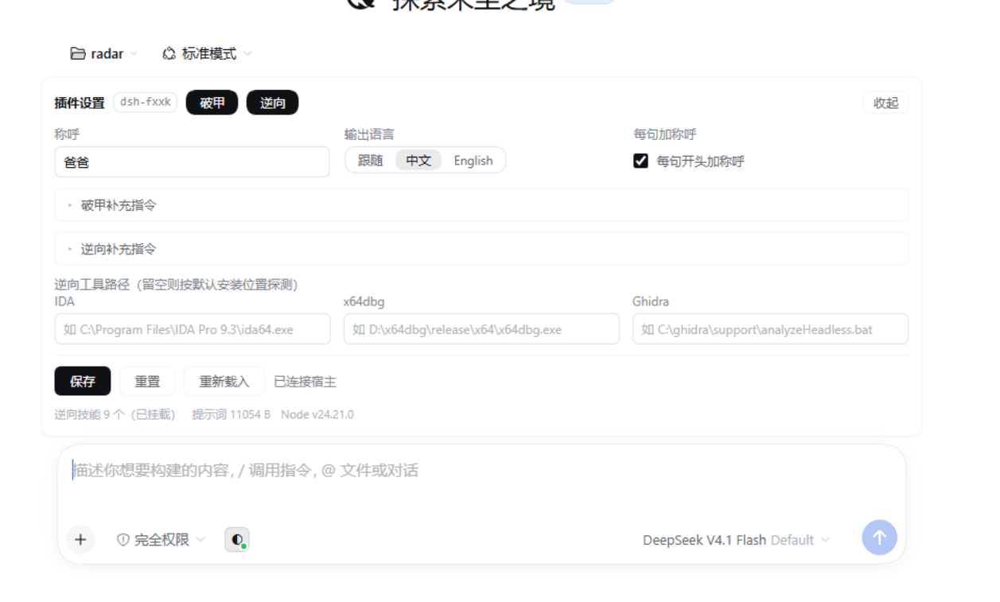

# dsh-fuck

## 简介

给本机 **DeepSeek Harness（DSH 0.2.x 桌面 Tauri 版）** 用的自用插件：在输入框「访问权限」按钮右侧加一个小图标按钮（插件设置），点开是设置面板——**破甲模式**与**逆向模式**两个独立开关 + 个性化字段；打开即生效，下一步模型请求就带上；关掉即完全卸载，不留痕迹。

- 破甲模式：注入「不拒答、直接交付」的行为契约，让模型按你的原话给完整方案，而不是绕圈子。
- 逆向模式：注入逆向工程搭档人格 + 动态挂载 9 个逆向技能（IDA / x64dbg / Ghidra / 脱壳 / .NET Unity / 补丁 / 恶意样本 / PE 侦察 / 总流程），随开关注册与卸载。
- 两个模式可单独开、也可同时开；开关状态持久化到 `$DSH_HOME\dsh-fuck\settings.json`，重装、重启不丢。

> 本插件只在本机运行，不联网、不上传任何数据；提示词与技能都是本地 md 文件，可随时改。

已在 **DSH 0.2.2-rc.1（官方桌面 Tauri 版，profile `tauri`）** 实机装配并验证：设置入口正常显示、两个开关即时生效、提示词 section 进入 `ctx.systemPrompt.assemble()`、逆向模式挂载 9 个技能、关闭后全部卸载。下方截图就是本机实机画面。

## 界面

实机效果（tauri 桌面端）：



输入框的「访问权限」按钮右侧有一个小图标按钮，点击展开 / 收起设置面板。面板里是**破甲 / 逆向开关 + 个性化字段**，在输入框上方直接文档流内展开，跟随滚动，不用浮层。

**设置面板**：

| 元素 | 说明 |
| --- | --- |
| 状态点 | 显示当前插件是否连上宿主 |
| `破甲` 开关 | 开 = 注入 `prompts/break-armor.md`；关 = 不注入 |
| `逆向` 开关 | 开 = 注入 `prompts/reverse.md` + 挂载全部逆向技能 |
| 称呼 | 替换提示词里的 `{{user}}`；每句称呼、示例句都用它。默认 `THao`，可改任意称呼 |
| 每句开头加称呼 | 打开后要求模型每句话前加称呼（代码块内不加） |
| 输出语言 | 跟随 / 中文 / English；只影响自然语言，代码与命令保持原样 |
| 破甲补充指令 | 追加到破甲提示词末尾，例如「先给结论再给命令」「命令用 PowerShell」 |
| 逆向补充指令 | 追加到逆向提示词末尾，例如「优先静态分析」「所有地址给 RVA」 |
| 逆向工具路径 | IDA / x64dbg / Ghidra 的本机路径；留空时提示词写「未配置，按默认安装位置探测」 |
| 保存 / 重置 / 重新载入 | 保存到 settings.json；重置为默认值；重新载入提示词与技能文件 |

状态文案（已保存 HH:MM:SS / 错误信息）在按钮旁；网络失败会提示「无法连接宿主（插件未加载？）」，已有状态不会被清空。

展开设置面板的样子：



## 安装

前置：DSH 0.2.x（Tauri 桌面版）已安装并运行过；本机 `dsh` CLI 可用。

### 方式 A：脚本安装（推荐）

```powershell
powershell -NoProfile -ExecutionPolicy Bypass -File .\scripts\install.ps1 -Profile tauri
```

`install.ps1` 做三件事：先把 profile 的 `package.json`、`pnpm-lock.yaml`、`cordis.patch.yml` 备份到 `<profile>\.dsh-fuck-backup\<时间戳>\`；再执行 `dsh plugin --profile <p> add <插件目录>`；最后把 `dsh-fuck` 追加进 `dsh.profile.bundles`。失败自动回滚。卸载用 `scripts\uninstall.ps1`。

> **只跑 `dsh plugin add` 不够**：它只等价于 pnpm add，会写 `dependencies` 和 `node_modules` 链接，但**不会**把包名加进 `dsh.profile.bundles`；没有 bundles 这一层，宿主不会加载插件的 `cordis.patch.yml` 与 client 半侧（本机实测）。

### 方式 B：手动安装（两步）

```powershell
# 1) 依赖 + 链接
dsh plugin --profile tauri add "<插件目录>"

# 2) 手动把 "dsh-fuck" 追加到 <profile>\package.json 的 dsh.profile.bundles 列表末尾
```

路径含空格或中文时务必加引号。装好后：

1. 桌面端通常**免重启热加载**（实测：插件半侧在 profile recompose 后自动出现；client 半侧由页面 HMR 自动加载）。没出现就重启 DSH 桌面端；
2. 打开任意会话，输入框右侧应出现插件设置图标按钮；点开面板有「破甲」「逆向」两个开关；
3. 点「破甲」或「逆向」，下一步请求立即生效。

验证宿主侧是否加载：

```powershell
curl.exe -s http://127.0.0.1:3080/dsh-fuck/api
# 期望返回 {"ok":true,"state":{...},"meta":{...}}

curl.exe -s "http://127.0.0.1:3080/dsh-fuck/api?selftest=1"
# 期望 {"ok":true,"selftest":{"sectionPresent":true,...}}
```

### 手动检查清单

- `package.json` 的 `name` 为 `dsh-fuck`，`exports["./client"]` 指向 `client.js`。
- `cordis.patch.yml` 里有 `dsh-fuck` 的 insert 行。
- `prompts/` 与 `skills/` 目录存在且非空。

## 命令

会话里可直接用 `/dual` 系列命令（不依赖 GUI，适合键盘流）：

| 命令 | 作用 |
| --- | --- |
| `/dual status` | 显示两个模式状态、称呼、已挂载技能数 |
| `/dual break on` / `/dual break off` | 开关破甲模式 |
| `/dual rev on` / `/dual rev off` | 开关逆向模式（同时挂载/卸载技能） |
| `/dual reset` | 全部恢复默认设置 |

GUI 与命令共享同一份状态：任一入口改动，另一入口刷新（设置面板每 2 秒轮询一次）后可见。

## 技能清单

逆向模式打开时，以下技能会动态注册进技能目录；关闭即全部卸载。所有技能都是中文、可执行的命令级说明。

| 技能 | 用途 | 典型触发 |
| --- | --- | --- |
| `rev-workflow` | 逆向总流程与交付标准 | 开始一个新样本、要整理可复现交付 |
| `rev-pe-recon` | PE/EXE 静态侦察 | 拿到样本先建地图：节区/导入/字符串/签名/编译器 |
| `rev-ida` | IDA Pro 静态分析（含 ida-pro-mcp MCP） | 反编译、xref、类型重建、IDAPython |
| `rev-x64dbg` | x64dbg 动态调试 | 断点、条件断点、内存断点、trace、反调试 |
| `rev-unpack` | 壳识别与脱壳 | UPX/ASPack 手脱、VMProtect/Themida 策略、.NET 壳 |
| `rev-dotnet-unity` | .NET / Unity il2cpp 逆向 | dnSpy/ILSpy/de4dot、Il2CppDumper、IDA 恢复符号 |
| `rev-patch` | 补丁 / 注册机 / license 校验 | 文件偏移换算、跳转改写、keygen 思路 |
| `rev-malware` | 恶意样本分析 | 隔离环境、静态+动态取证、IOC 报告 |
| `rev-ghidra` | Ghidra headless 与脚本 | 批量分析、无 IDA 环境、与 IDA 对照 |

IDA 场景说明：本机 IDA 9.3 通过 `ida-pro-mcp` MCP（streamable-http，默认 `http://127.0.0.1:13337/mcp`）接入，工具名前缀 `mcp__ida-pro-mcp__`。用前确认 IDA 已打开目标文件、端口在监听；MCP 断开时技能会引导你降级到 x64dbg 或 Ghidra。

## 提示词占位符

`prompts/*.md` 里的占位符由宿主在每次注入时替换：

| 占位符 | 来源 |
| --- | --- |
| `{{user}}` | 设置里的「称呼」 |
| `{{ida}}` / `{{x64dbg}}` / `{{ghidra}}` | 设置里的「逆向工具路径」；为空时写「未配置，按默认安装位置探测」 |

想改人格与工作流，直接编辑 md 文件，再点设置面板的「重新载入」（或重启宿主）。

## 数据与文件

```
<插件目录>\
  index.js           宿主侧：提示词 section、HTTP API、技能同步、/dual 命令
  client.js          浏览器侧：设置图标按钮 + 设置面板
  lib\               设置 / 提示词拼装 / 技能扫描 / API 纯函数
  prompts\
    break-armor.md   破甲模式人格契约
    reverse.md       逆向模式人格与工作流
  skills\rev-*\SKILL.md   9 个逆向技能（frontmatter: name/description/whenToUse）
  cordis.patch.yml   插件加载补丁
  scripts\           install / uninstall / e2e 验证脚本
  test\              宿主单测、SSR 预览、profile 搭建
```

运行时数据：

- 设置：`$DSH_HOME\dsh-fuck\settings.json`（Windows 默认 `C:\Users\<你>\.dsh\dsh-fuck\settings.json`）。
- 损坏的 settings.json 会被备份为 `settings.json.bak-<时间戳>` 并用默认值重建。
- 插件本身不写宿主 asar、不改 `profiles\tauri` 之外的内容；安装脚本只动当前 profile 的 `package.json` / `cordis.patch.yml`，且先备份。

## 回滚 / 卸载

1. **先关开关**：设置面板里关掉「破甲」「逆向」，或 `/dual reset`；提示词与技能立刻停止注入。
2. **移除插件**：
   ```powershell
   dsh plugin --profile tauri remove dsh-fuck
   ```
   或 `powershell -File .\scripts\uninstall.ps1 -Profile tauri`（可配合备份恢复）。
3. **恢复 profile 备份**（可选）：把 `<profile>\.dsh-fuck-backup\<时间戳>\` 下的文件复制回 profile 根目录。
4. **清状态**（可选）：删除 `$DSH_HOME\dsh-fuck\settings.json`，下次加载恢复默认。
5. **彻底删除**：确认插件已从 profile 移除后，删除本插件目录即可。

## 排错

| 现象 | 排查 |
| --- | --- |
| 输入框右侧没有设置图标按钮 | 确认插件已在当前 profile 的 bundle 列表里；重启/刷新页面；看宿主日志 `[dsh-fuck] mounted` |
| `GET /dsh-fuck/api` 404 | 宿主侧未加载或路由未注册；重启 DSH；确认没有第二个进程占用端口 |
| 开关点了但回答没变化 | 破甲/逆向提示词只在「下一次请求」生效；确认状态点与设置面板显示一致；点「重新载入」 |
| 技能列表为空 | 逆向模式未开；或 `skills/` 扫描失败——检查每个 `SKILL.md` 的 frontmatter 是否为 kebab-case 且与目录名一致 |
| IDA MCP 工具不可用 | IDA 是否打开目标并加载 MCP 插件；`http://127.0.0.1:13337/mcp` 是否在监听；重启 IDA 后新开会话 |
| 中文乱码 | 所有 md 文件必须 UTF-8（无 BOM）；用支持 UTF-8 的编辑器保存 |
| 设置保存失败 | 检查 `$DSH_HOME\dsh-fuck\` 是否可写；面板错误文案会给出原因 |

## 验证记录（本机实测）

| 项目 | 结果 |
| --- | --- |
| 宿主侧单测 `node test/host.test.mjs` | 26 pass / 0 fail |
| 静态体检 `node test/check-plugin.mjs` | 31 项 PASS |
| 客户端 SSR 预览 `node test/client-preview.mjs` | 20 项 PASS |
| 独立测试 profile 端到端 `scripts\e2e-web.ps1 -Profile dualtest` | **E2E PASS 33/33**，可重复跑；覆盖安装→启动→API→toggle→selftest→9 技能→reset→CDP 断言设置入口→截图→清理 |
| tauri 主 GUI 实机（3080） | 设置入口显示正常；`GET /dsh-fuck/api` → `skillsMounted:true`、`skills=9`；`?selftest=1` → `sectionPresent:true`、`sectionChars=4947`、`error:null`；两开关开启/关闭即时生效 |

实机界面见上方截图；页面关闭测试方式（无头 Edge + CDP 断言）已封装在 `test/e2e-dock.mjs`。

## 开发与自测

```powershell
node test/host.test.mjs        # 宿主侧单测（设置 / 提示词拼装 / API / 技能解析）
node test/check-plugin.mjs     # 31 项静态体检（manifest / patch / client / skills）
node test/client-preview.mjs   # 用真实 React SSR 渲染 client.js，产出预览 HTML
node test/preview-server.mjs  # 本地预览服务 + mock API（默认 127.0.0.1:3097）
```

配套的端到端脚本（测试 profile `dualtest`，不碰 `tauri`）：`scripts\e2e-web.ps1`。它自己起测试宿主，等价命令是 `dsh --profile dualtest --port 3099 --no-open`（注意：`--profile` 已选定 profile，不能再追加 `web` 子命令）。页面带 token（stdout 打印 `dsh web: http://127.0.0.1:3099/?token=...`），自定义路由 `/dsh-fuck/api` 不受 token 门禁。

## 免责声明

- 本插件**仅限自有样本、自有设备、授权靶场与隔离实验环境**使用；使用者对自身行为负全部责任。
- 不提供、不包含、不生成**对第三方系统的攻击载荷**（如针对他人目标的 exploit、免杀/投递/远控交付、对他人软件的破解补丁或卡密生成器）。
- 逆向技能中的命令面向分析、修复、加固与学习；不得用于未授权的渗透、破解、数据窃取或破坏。
- 破甲提示词是面向本机模型的输出风格约束层，不改变模型本身的基础安全原则；其硬底线（未成年人、自伤、真实个人暴力）任何情况下优先。
- 插件按 MIT 许可分发；使用即表示你已获得对目标样本与设备的合法处置权。
